# Paperless Factory: The Project Guide

**Who this is for:** managers who want to know what the system does, and new team members who need to find their way around the code to fix a bug or add a feature.

**How to read it:** it works like peeling an onion. Each layer goes one step deeper than the one before.

| Layer | Question it answers | Who usually stops here |
|---|---|---|
| [1. The one-minute view](#layer-1--the-one-minute-view) | What is this, and why does it exist? | Everyone |
| [2. Who uses it, and for what](#layer-2--who-uses-it-and-for-what) | Which people use it, and what can each one do? | Managers |
| [3. The big pieces](#layer-3--the-big-pieces) | What is the system made of? | Managers, architects |
| [4. The business processes](#layer-4--the-business-processes-step-by-step) | How does work flow through it, step by step? | Managers, testers, developers |
| [5. The modules](#layer-5--the-modules-frontend-and-backend) | Which part of the code does what? | Developers |
| [6. The data](#layer-6--the-data) | What is stored, and how is it linked? | Developers |
| [7. Inside the hard parts](#layer-7--inside-the-hard-parts) | How do reading documents, approvals, signatures and filing work inside? | Developers |
| [8. Working on the project](#layer-8--working-on-the-project) | How do I run it, test it, fix a bug, add a feature? | Developers |
| [9. Glossary](#layer-9--glossary) | What does this word mean? | Everyone |

The diagrams are written in *Mermaid*. They draw themselves in GitHub, GitLab and VS Code (with a Markdown preview).

---

## Layer 1 — The one-minute view

### What it is

**Paperless Factory** is a web application for a factory's **quality records**.

In a factory, people check things every day:
- Is the light bright enough?
- Is this part within its size limits?
- Is this sheet metal free of scratches?

They write the answers on **paper check sheets**. Managers then sign them, and the sheets are filed in cupboards.

Paperless Factory replaces that paper. It does four things:

1. **Turns a paper form into a digital form.** You upload a photo, PDF or Excel file of the paper sheet, and the system builds an editable on-screen form from it.
2. **Lets people fill the form on screen.** Readings are checked against their limits as you type: **OK** or **N-OK** (not OK).
3. **Sends each filled record through a fixed approval chain.** Each approver signs on screen.
4. **Files the approved record automatically.** It goes into a tidy folder by team, form, year, month and day. It can be found and printed (with signatures) years later.

Changes are controlled too. Changing a form, or correcting a filed record, needs a formal **change request** that someone must approve.

### Why it matters

| Before (paper) | After (Paperless Factory) |
|---|---|
| Out-of-limit readings noticed late, if at all | Flagged the moment they are typed; the responsible manager is told at once |
| Signatures chased around the plant | Each approver gets a notification, and signs on screen |
| Records lost, misfiled, hard to audit | Filed automatically, searchable, with a full history of who did what and when |
| Forms changed informally | Every change goes through an approved change request and a new revision |

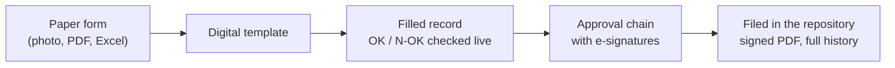

---

## Layer 2 — Who uses it and for what

### The people (roles)

| Role | Who in the plant | What they do in the system |
|---|---|---|
| **Administrator** | IT / system owner | Builds templates from paper forms, manages people, teams and roles |
| **QMS Coordinator** | Quality system owner | Approves new templates and template changes; decides change requests |
| **Process Owner (PO)** | Line or area owner | Fills the record, gives the first approval, takes the final decision |
| **Overall Process Owner (OPO)** | Head of the quality team | Second approval; clears out-of-limit (N-OK) findings; files the record |
| **Quality CFT** | Cross-functional reviewers (2 or more) | Joint review: each one *agrees* or *objects* |
| **Everyone signed in** | All of the above | Dashboard, notifications, Doc Repository (reading filed records), Activity Log |

Each **quality team** (Process Quality **PQ**, Supplier Quality **SQ**, Customer Quality **CQ**) has its own templates and its own people. The same person can hold different roles on different templates. **Four eyes rule:** on one record, the PO, the OPO and the CFT must be *different* people. The system enforces this.

### Use cases, by role

What each role can do (a "use case" diagram):

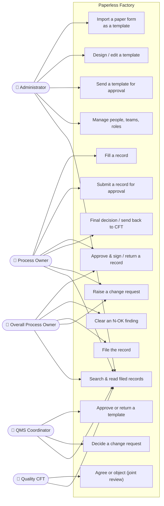

### What each person sees in the menu

| Menu item | Everyone | Admin only |
|---|---|---|
| Dashboard | ✓ | |
| Resources Library (released templates, to start a record) | ✓ | |
| My Documents (records I fill) | ✓ | |
| My Approvals (things waiting on me) | ✓ | |
| Doc Repository (filed records) | ✓ | |
| Change Request | ✓ | |
| Activity Log | ✓ | |
| Template Builder | | ✓ |
| Template Repo (all templates and revisions) | | ✓ |
| Roles & Permissions (people and teams) | | ✓ |

---

## Layer 3 — The big pieces

### Context: the system and what is around it

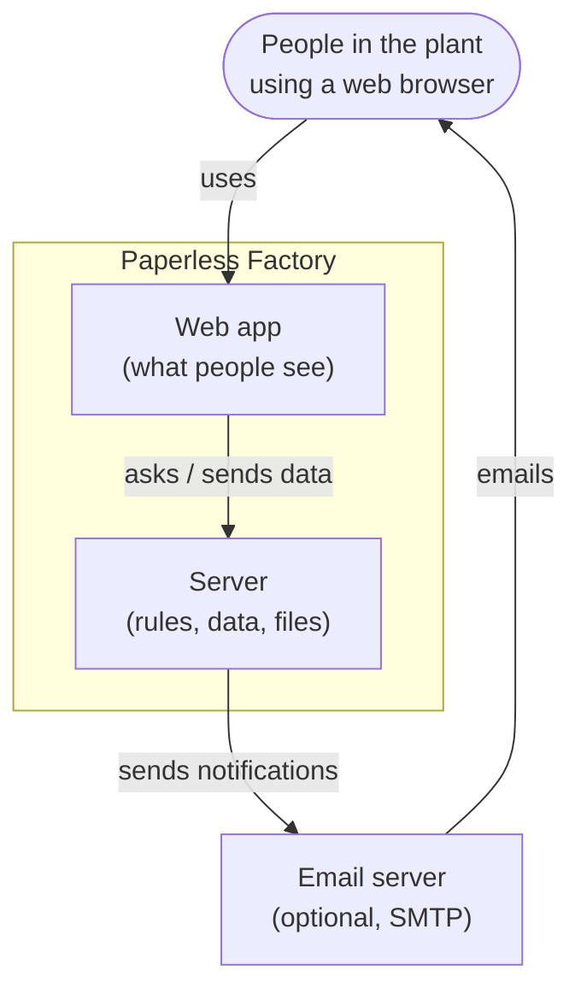

If no email server is set up, notifications still work in the app (the 🔔 bell). They are just not emailed.

### Containers: the deployable parts

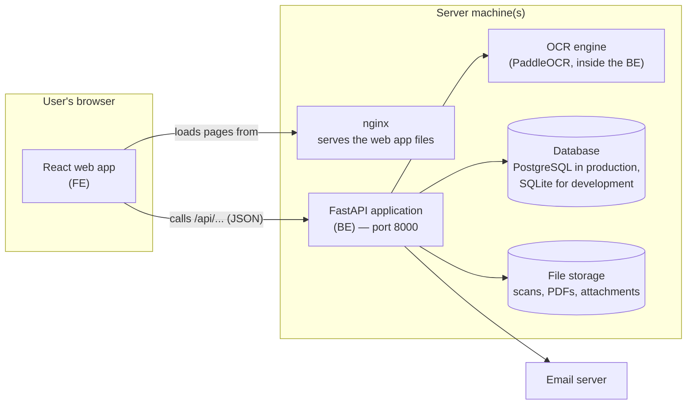

| Part | Technology | Where in the code |
|---|---|---|
| Web app (**FE** = frontend) | React 19, TypeScript, Vite, MUI (Material UI), Redux Toolkit / RTK Query, AG Grid | `FE/harman-paperless-factoryFE-main/` |
| Server (**BE** = backend) | Python, FastAPI, SQLAlchemy, Pydantic | `BE/` |
| Document reading (**OCR**) | PaddleOCR + OpenCV (photos and PDFs), openpyxl / xlrd (Excel) | `BE/app/ocr/` |
| Database | PostgreSQL (production) or SQLite (`BE/data/documents.db`, development) | models in `BE/app/models*.py` |
| Files | A folder on disk (`BE/data/storage/`) | `BE/app/services/evidence_service.py` |
| Packaging | Docker images (`BE/Dockerfile`, `FE/.../Dockerfile` + `nginx.conf`) | |

### How a click travels through the system

Every action follows the same path, for example *"save the readings"*:

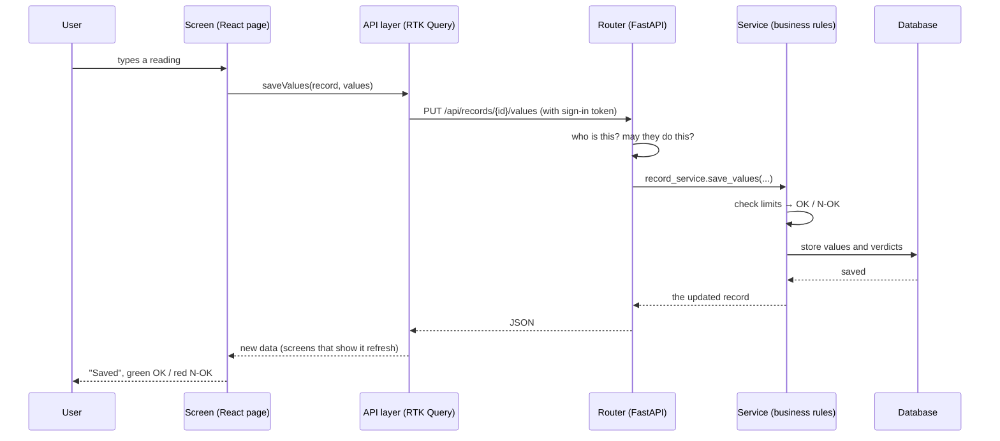

The **golden rule of this codebase** is that each layer has one job:
- **Screens** only show things and collect input.
- **The API layer** only talks to the server.
- **Routers** only check who you are and translate HTTP.
- **Services** hold every business rule.
- **Models** only describe the stored data.

When you look for "where is the rule that…", look in a **service**.

---

## Layer 4 — The business processes, step by step

There are four main processes. Each one is a series of states (shown as boxes) and the actions that move work between them.

### 4.1 Template lifecycle (from paper form to released form)

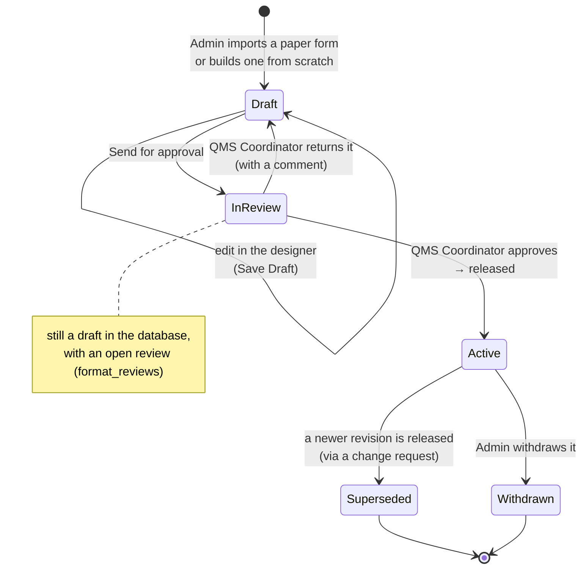

- Only an **Active** (released) template appears in the Resources Library and can be filled.
- A released template **cannot be edited**. A change needs a change request (4.3), which creates a new **revision** (00 → 01 → 02…).
- Old records keep pointing at the revision they were filled on. History is never rewritten.

### 4.2 Record lifecycle (filling and approving a check sheet)

This is the heart of the system.

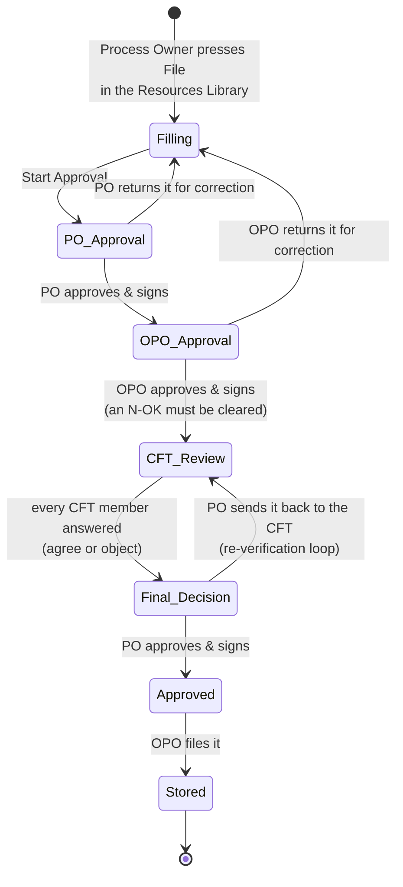

What happens along the way:

| Moment | What the system does automatically |
|---|---|
| A reading is typed | Compares it with its limits and shows **OK** (green) or **N-OK** (red) |
| Start Approval | Builds the approval chain from the template's people; notifies the PO; if any reading is N-OK, **flags it to the OPO immediately** |
| Each approval | Stores the signature, the time and the comment; notifies the next person |
| Joint review | Waits until **all** CFT members have answered; an objection is carried to the final decision |
| Send back to CFT | Starts the CFT review again; nobody's earlier answer counts; the record turns red |
| Filing | Refused while an N-OK is not cleared; otherwise stores the record in its folder (see 7.5) |

**Traffic light** (shown as a coloured dot on every record):

| Colour | Meaning |
|---|---|
| 🟡 Yellow | Being filled, or with the PO / OPO |
| 🟢 Green | Both owners approved; OK for final review, or filed |
| 🔴 Red | Needs attention: an N-OK not cleared, a CFT objection, a re-verification, or the CFT review is late. The label says which. |

### 4.3 Document Change Request (DCR): changing a template

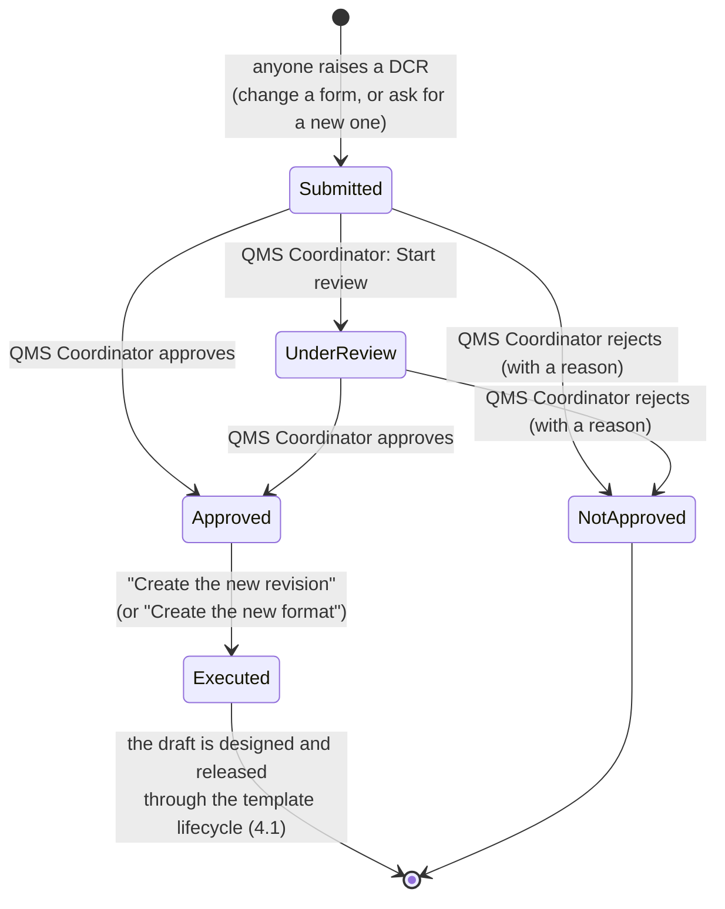

The raiser cannot approve their own request, and only one open DCR per template is allowed.

### 4.4 Record Change Request (RCR): correcting a filed record

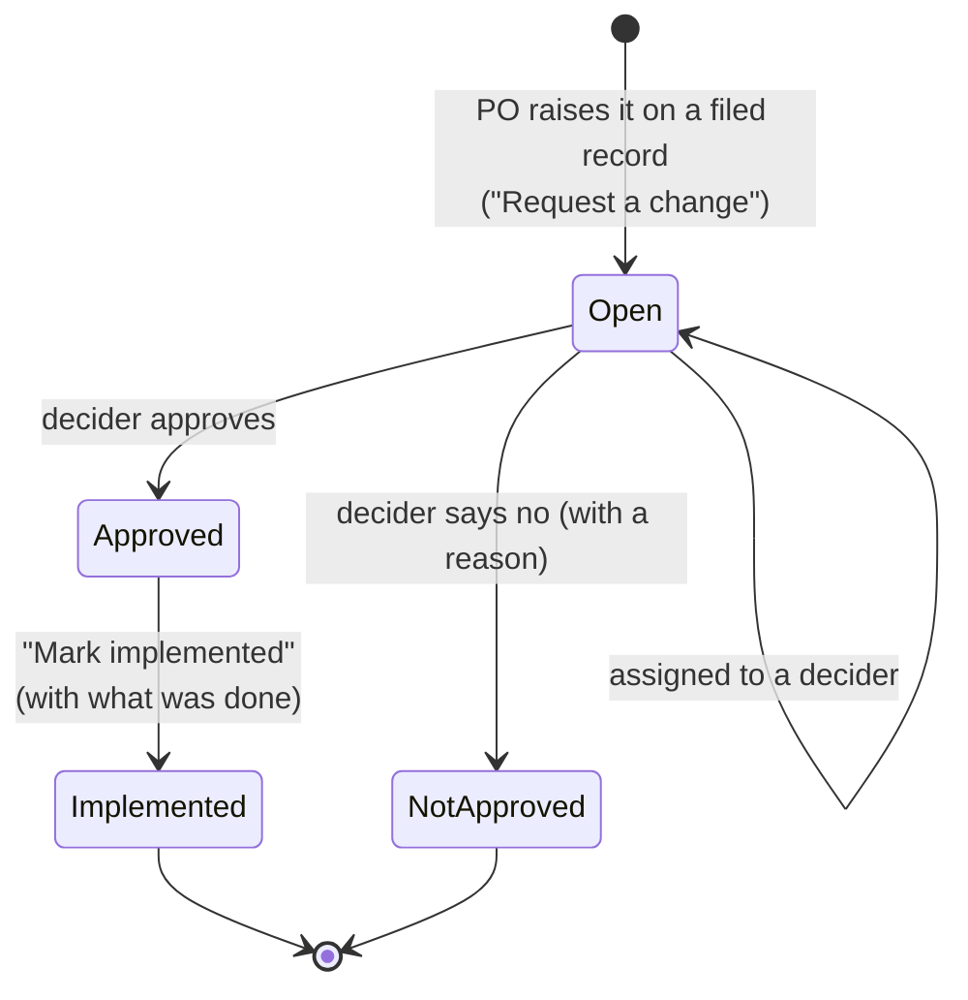

Every step is written into the record's **trail**, which is visible in the Doc Repository.

### 4.5 The whole day in one picture

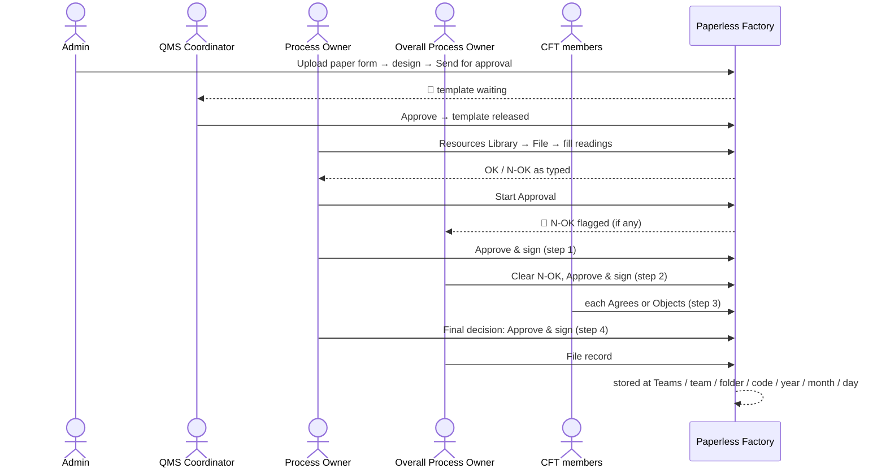

---

## Layer 5 — The modules (frontend and backend)

### 5.1 How the code is laid out

```
Harman/
├── BE/                            ← the server (Python)
│   ├── app/
│   │   ├── main.py                ← starts the app, security headers, error handlers
│   │   ├── config.py              ← settings from .env
│   │   ├── database.py            ← database connection
│   │   ├── models.py              ← tables: users, roles, documents, workflows, signatures…
│   │   ├── models_qms.py          ← tables: formats (templates), records, change requests…
│   │   ├── schemas.py             ← shapes of incoming / outgoing data
│   │   ├── routers/               ← one file per area of the API (the "front doors")
│   │   ├── services/              ← the business rules (the "brains")
│   │   ├── ocr/                   ← reading paper forms (photos, PDFs, Excel)
│   │   ├── middleware/            ← error handling, rate limiting
│   │   └── utils/                 ← time zone (IST), backups, logging…
│   ├── tests/                     ← automated tests (pytest)
│   ├── scripts/                   ← seeding, checks, data fixes
│   ├── cli.py                     ← command line (init, serve, users, records…)
│   └── data/                      ← database file and stored files (development)
├── FE/harman-paperless-factoryFE-main/   ← the web app (React)
│   ├── src/
│   │   ├── App.tsx                ← the list of screens (routes)
│   │   ├── api/                   ← talking to the server (one file per area)
│   │   ├── base/                  ← shared building blocks (tables, dialogs, status dots…)
│   │   ├── <screen folders>/      ← one folder per screen (see 5.2)
│   │   └── vendor/react-form-builder/  ← the form designer engine (our own copy)
│   └── e2e/                       ← browser tests (Playwright)
├── sample/                        ← the client's sample paper forms
├── README.md, INTEGRATION_PLAN.md, TEST_PLAN.md, PROJECT_GUIDE.md
```

### 5.2 Frontend modules (screens)

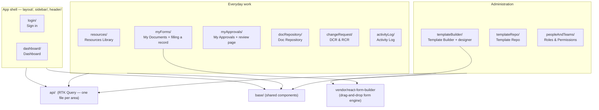

| Screen | Folder | Main files | Server area it uses |
|---|---|---|---|
| Sign in | `login/` | `index.tsx` | `api/auth.api.ts` → `/api/auth` |
| Dashboard | `dashboard/` | `DashboardPage.tsx` | `/api/actions/dashboard`, `/api/my-approvals`, `/api/audit` |
| Resources Library | `resources/` | `ResourceDashboad.tsx` | `/api/formats` (released, callable) |
| My Documents / fill a record | `myForms/` | `MyFormsDash.tsx`, `FormDetails.tsx`, `RecordForm.tsx`, `ValueCell.tsx`, `ApprovalSetupPage.tsx` | `/api/records` |
| My Approvals / review | `myApprovals/` | `index.tsx`, `ApprovalReview.tsx`, `TemplateApprovals.tsx` | `/api/my-approvals`, `/api/workflow`, `/api/signatures` |
| Doc Repository | `docRepository/` | `index.tsx`, `RecordFileDetail.tsx` | `/api/documents/repository` |
| Change Request | `changeRequest/` | `index.tsx`, `ChnageRequestDetails.tsx`, `RaiseDcrDialog.tsx` | `/api/change-requests`, `/api/record-change-requests` |
| Activity Log | `activityLog/` | `index.tsx` | `/api/audit` |
| Template Builder | `templateBuilder/` | `index.tsx`, `designer/index.tsx`, `designer/UploadDocumentDialog.tsx`, `designer/FieldProperties.tsx` | `/api/formats`, `/api/ocr/template` |
| Template Repo | `templateRepo/` | `index.tsx`, `TemplateDetail.tsx` | `/api/formats/repository` |
| People & Teams | `peopleAndTeams/` | `index.tsx` | `/api/auth/users`, `/api/roles`, `/api/departments` |
| Notifications, Settings | `header/` | `NotificationsPage.tsx`, `Settings.tsx` | `/api/records/notifications/…`, `/api/auth` |

**Shared pieces worth knowing** (`src/base/`, `src/utils/`, `src/helpers/`):
- `base/aggrid`: the standard data table.
- `base/dialog`: dialogs and inputs.
- `base/feedback`: loading spinners, error messages, and "Try again" when it can help.
- `base/readings/ReadingsTable.tsx`: a record's readings on the review and repository pages.
- `base/status/RagDot.tsx`: the traffic-light dot.
- `base/signature/SignaturePad.tsx`: drawing a signature.
- `helpers/index.ts`: the HTTP client; adds the sign-in token; on "signed out" sends the person to the login page and back afterwards.
- `utils/openAuthedFile.ts`: opening and downloading files that need sign-in.

### 5.3 Backend modules (routers → services)

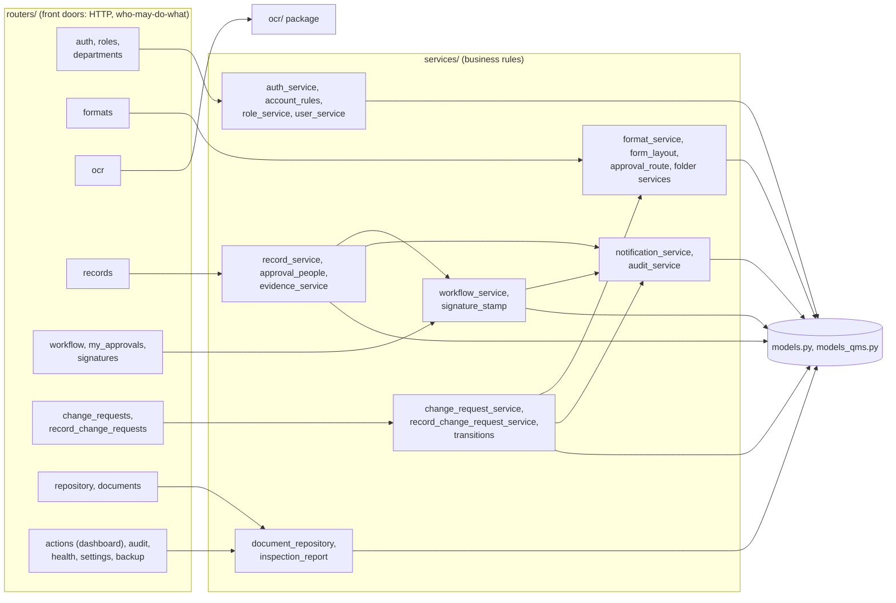

**API areas** (all under `/api`):

| Prefix | Router file | What it is for |
|---|---|---|
| `/api/auth` | `auth.py` | Sign in / out, my account, password, users |
| `/api/roles`, `/api/departments` | `roles.py`, `departments.py` | Roles and permissions, departments |
| `/api/formats` | `formats.py` | Templates: create, edit, approve, release, people, folders, next code |
| `/api/ocr` | `ocr.py` | Turning an uploaded paper form into a template |
| `/api/records` | `records.py` | Records: start, fill, attach hard copy and photos, submit, return, file; notifications |
| `/api/workflow` | `workflow.py` | Approval steps: decide (approve / object…), sign |
| `/api/my-approvals` | `my_approvals.py` | "What is waiting on me" |
| `/api/signatures` | `signatures.py` | The signed PDF (signatures stamped on) |
| `/api/change-requests` | `change_requests.py` | DCRs |
| `/api/record-change-requests` | `record_change_requests.py` | RCRs |
| `/api/documents/repository` | `repository.py` | Doc Repository: filed records, summary, timeline and trail |
| `/api/documents` | `documents.py` | Stored files (view / download) |
| `/api/actions` | `actions.py` | Dashboard figures, corrective actions |
| `/api/audit` | `audit.py` | Activity Log |
| `/api/health`, `/api/settings`, `/api/backup`, `/api/admin`, `/api/security` | | Operations and administration |

With the server running in development, the full list with every field is at **http://127.0.0.1:8000/docs**.

**Key services, one line each:**

| Service | Its job |
|---|---|
| `format_service.py` | Templates: create, revise, release, readiness checks, next code, record periods, filing folders |
| `form_layout.py` | Turns a designed form into the list of fields a record collects; checks a design for mistakes |
| `record_service.py` | Records: start, save values (OK / N-OK), submit, return, N-OK flag, filing, traffic light |
| `approval_people.py` | Who may approve a record; the four-eyes rule |
| `workflow_service.py` | The approval chain: steps, who acts, decisions, signatures, escalation |
| `signature_stamp.py` | Stamps signatures onto the record's PDF |
| `evidence_service.py` | Accepting a scanned hard copy: checks it, turns photos into PDF, stores it |
| `change_request_service.py`, `record_change_request_service.py` | DCRs and RCRs |
| `transitions.py` | Makes a status change happen once only, even on double clicks |
| `notification_service.py` | Writes notifications (bell) and sends emails |
| `inspection_report.py` | Dashboard figures; "a check is due and not started" alerts |
| `document_repository.py` | Lists and searches filed records |
| `auth_service.py`, `account_rules.py` | Sign-in tokens, revocation, password and username rules |
| `audit_service.py` | Writes the Activity Log |

---

## Layer 6 — The data

### 6.1 The main tables and how they link

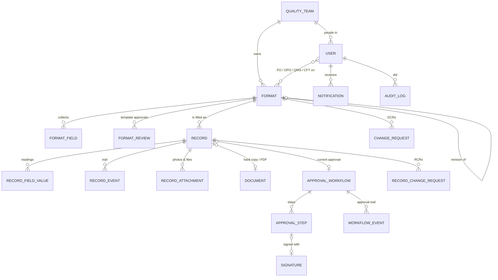

### 6.2 What each table holds (plain words)

| Table | Holds | Key columns |
|---|---|---|
| `formats` | A **template**, one row per revision | `code` (QF-PQ-002), `title`, `revision` (00, 01…), `status` (draft / active / superseded / withdrawn; "in review" means a draft with an open row in `format_reviews`), `frequency`, `team_id`, the four responsibilities, `layout` (the designed form as JSON), `storage_path` (library folder) |
| `format_fields` | Each thing a template **collects** (a reading, a ✓/✗ cell…) | `label`, `field_type` (text / number / select / date…), `spec_min`, `spec_max`, `unit`, `required`, `layout_key` (where it sits on the form) |
| `format_reviews` | A template's approval (by the QMS Coordinator) | `status`, `steps_json`, `submitted_by` |
| `records` | One **filled check sheet** | `number` (REC-QF-PQ-002-20261024-01), `format_id`, `format_revision`, `stage` (see 4.2), `rag_status`, `period_key`, N-OK flag fields, `document_id`, `workflow_id`, `storage_path` |
| `record_field_values` | Each reading on a record | `value`, `numeric_value`, `in_spec` (true = OK, false = N-OK), a copy of the limits |
| `record_events` | The record's history ("submitted", "returned", "filed"…) | `kind`, `summary`, `detail`, `actor_id`, `created_at` |
| `documents` | A stored file (hard-copy scan, generated sheet) | `file_path`, `file_hash` (spots the same scan used twice), `mime_type` |
| `approval_workflows`, `approval_steps`, `workflow_events` | The approval chain and its trail | step `name`, `status`, `assignees`, `decided_by`, `signature_id` |
| `signatures` | A drawn or typed signature | `data_url` (the image), `name`, `designation` (job title at the time), `signed_at` |
| `change_requests`, `record_change_requests` | DCRs and RCRs | `number`, `status`, `reason`, decision fields |
| `notifications` | Every notification (bell and email) | `kind`, `subject`, `to_user_id`, `related_type` + `related_id` (what it links to) |
| `audit_logs` | The Activity Log | `action`, `resource_type`, `resource_id`, `user_id`, `created_at` |
| `users`, `roles`, `quality_teams`, `departments` | People and organisation | `username`, `job_title`, `quality_team_id`, role permissions |
| `token_revocations` | Signed-out / revoked sign-in tokens | `jti` or `user_id` + `revoked_before` |

### 6.3 Where files live

| What | Where (development) |
|---|---|
| Database | `BE/data/documents.db` |
| Hard-copy scans and generated PDFs | `BE/data/storage/evidence/<date>/…` |
| Record attachments | `BE/data/storage/records/<record id>/attachments/…` |
| Blank forms | `BE/data/storage/…` (path stored on the format) |

All times are **stored in UTC**. People always see times, days and months in **India time (IST)**; the conversion is in `BE/app/utils/ist.py`. Record numbers, periods ("which day is this check for") and filing folders also follow the plant's calendar (IST).

---

## Layer 7 — Inside the hard parts

### 7.1 Turning a paper form into a template (OCR and Excel import)

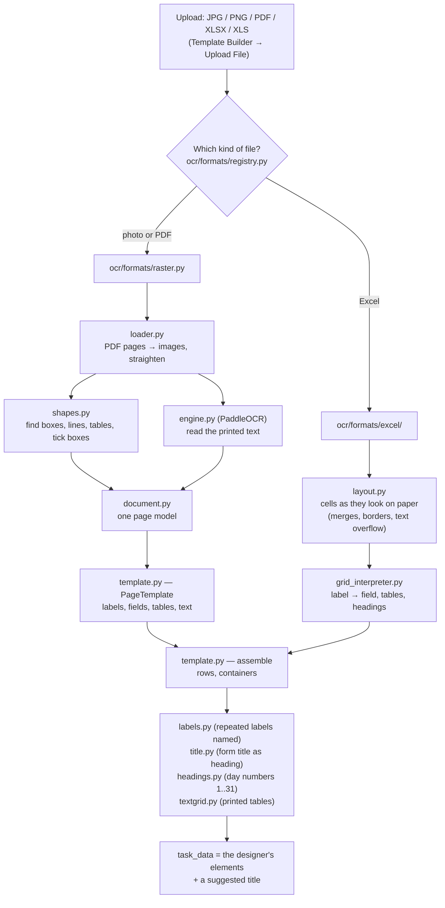

Important points:
- The result is a **starting point**. The administrator checks it in the designer and fixes anything the machine misread.
- **The same paper form gives the same template** whether it arrives as a photo, a PDF or an Excel file. Tests check this (`BE/tests/ocr/test_import_parity.py`, `test_client_scans.py`).
- Excel is read **exactly** (no OCR). Photos and PDFs take about 3–15 seconds a page on a normal CPU.
- To support a new file type, add a "format handler" in `ocr/formats/` and register it (see 8.5).

### 7.2 The form designer and what a template "collects"

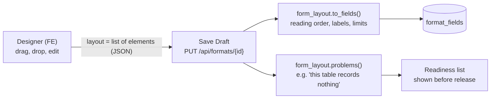

- The **layout** stores how the form *looks*: headings, rows, tables, merged cells.
- The **fields** store what the form *collects*. They are worked out from the layout every time it is saved, so the two never disagree.
- A table cell becomes a field named after its row and column (for example *"2 · Lux level (Sta.3) · 1st – DATE 24"*). Its address (`layout_key`) is `field_name:row:column`.
- **Rules:**
  - A number cell with limits is judged OK / N-OK.
  - A ✓/✗ cell is OK when ✓.
  - A cell is required only if the designer ticks "Required".
- The designer engine is our own copy of *react-form-builder* in `FE/.../src/vendor/react-form-builder/`. The large table editor is `table-editor.jsx`; the side panel is `templateBuilder/designer/FieldProperties.tsx`.

### 7.3 The approval chain (who acts, and the four-eyes rule)

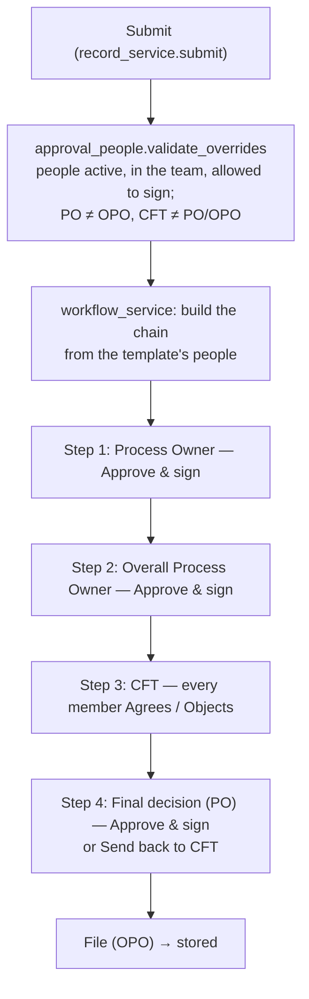

- **Who may act** on a step is decided by the server, never by the screen. The screen only shows the buttons the server allows (`can` flags in the API answer).
- **Signatures:**
  - The name and job title come from the signer's account, not from the browser.
  - The signature image is shown to its owner and to administrators only.
  - Everyone sees it stamped on the PDF.
- **N-OK:** the OPO is told the moment the record is submitted. Filing is refused until the OPO has cleared it, with the action taken.
- **Blank required entries** do not block submission (process rule B3). They are listed on the set-up page and on every approver's review page.

### 7.4 The signed PDF

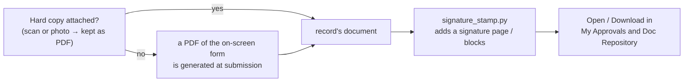

A hard copy must be a readable PDF or a picture. Empty, broken, password-protected or disguised files are refused with a clear reason, before anything is stored.

### 7.5 Filing: where a record ends up

The folder is built from the template's library folder, its code, and the record's period:

| Frequency | Folder |
|---|---|
| Per shift, Daily | `Teams / Process Quality / Inspection Logs / QF-PQ-002 / 2026 / 10-Oct / 24` |
| Weekly | `… / QF-PQ-00x / 2026 / W43` |
| Monthly | `… / QF-PQ-003 / 2026 / 10-Oct` |
| Quarterly / Half-yearly / Yearly | `… / 2026 / Q4`, `… / 2026 / H2`, `… / 2026` |
| Per event | `… / 2026 / 10-Oct` |

The code is in `format_service.storage_segments()` and `storage_root()`. Nobody creates these folders by hand.

### 7.6 Notifications

Each important event writes one row in `notifications`, which shows in the 🔔 bell, and emails it when an email server is set up. The screen a notification opens is decided in `FE/.../src/api/notifications.api.ts` (`notificationLink`) from its `related_type`.

| Event | Who is told |
|---|---|
| Record submitted / next step reached | The person whose step it is |
| N-OK readings | Overall Process Owner (the flag to act on); PO and QMS Coordinator ("inspection failed") |
| Record returned / sent back / filed | The person who filled it, and the owners |
| A check due this period not started | The Process Owner (not for "per event" forms) |
| Template sent for approval / approved / returned | Reviewers / the author |
| DCR raised / decided / executed | QMS Coordinator / raiser and owner (and admins for a new-format draft) |
| RCR raised / decided / implemented | Decider / raiser |

### 7.7 Security in brief

| Topic | How it works | Where |
|---|---|---|
| Signing in | Username and password → a token valid for a set time; sent with every request | `auth_service.py`, `routers/auth.py` |
| Signing out | That token is revoked; a password change, reset or deactivation revokes all of the person's tokens | `auth_service.revoke_*`, `token_revocations` table |
| Permissions | Each role carries permissions (`formats.manage`, `records.fill`, `change_requests.approve`…); each step also checks *who you are on this record* | `role_service.py`, the services |
| Passwords | At least 8 characters, three kinds of characters | `account_rules.py` |
| Files | Type decided by the server, never shown as a web page, content checked | `file_utils.py`, `evidence_service.py` |
| Double clicks | Status changes happen once only | `transitions.py` |
| Headers | `nosniff`, frame and referrer protection on every answer | `main.py`, FE `nginx.conf` |
| Defaults | Sign-in is required unless explicitly turned off; API docs are hidden in production | `config.py`, `main.py` |

---

## Layer 8 — Working on the project

### 8.1 Run it on your machine

**Backend (server):**
```bash
cd BE
python -m venv .venv
.venv\Scripts\activate            # Windows   (Linux/Mac: source .venv/bin/activate)
pip install -r requirements.txt
pip install -r requirements-ocr.txt  # only to read photos and PDFs
copy .env.example .env             # then set SECRET_KEY etc.
python cli.py init                 # database, folders, teams
python scripts/seed_quality_records.py   # demo people and templates (password Harman@2026)
python cli.py serve                # http://127.0.0.1:8000   (API docs: /docs)
```

**Frontend (web app):**
```bash
cd FE/harman-paperless-factoryFE-main
npm install
# .env contains:  VITE_API_URL=http://127.0.0.1:8000
npm run dev                        # http://127.0.0.1:5173
```

Sign in as `admin`, or as one of the demo people: `r.kumar`, `s.iyer`, `p.nair`, `a.deshmukh`, `m.shaikh`, `k.reddy`, `d.varma`, `a.sharma`.

### 8.2 The checks to run before handing over a change

| Check | Command | Expect |
|---|---|---|
| Backend tests | `cd BE && .venv\Scripts\python -m pytest tests -q` | all pass |
| Document-reading tests (slow) | `set RUN_OCR_TESTS=1` then `pytest tests/ocr -q` | all pass |
| Whole process against a running server | `python scripts/validate_workflow.py --url http://127.0.0.1:8000` | every check passes |
| Frontend ↔ backend contract | `python scripts/check_frontend_contract.py http://127.0.0.1:5173` | every check passes |
| Frontend types and style | `npx tsc -b` and `npx eslint .` | no output |
| Browser tests | `npx playwright test` (set `E2E_BASE_URL` if not 5173) | all pass |
| Production build | `npx vite build` | builds |

`validate_workflow.py`, the contract check and the browser tests **create data**. Run them against a copy of the database, not the real one.

### 8.3 How to find where something happens

| I want to change… | Look first in… |
|---|---|
| What a screen shows | `FE/src/<screen folder>/` (see 5.2) |
| The text on a button or message | The screen's `.tsx` file (search for the text) |
| A rule ("who may approve", "when is it N-OK") | `BE/app/services/` (see 5.3) |
| Who may call an API | The router in `BE/app/routers/` + the service it calls |
| What is stored | `BE/app/models.py`, `BE/app/models_qms.py` |
| How a paper form is read | `BE/app/ocr/` (see 7.1) |
| The designer | `FE/src/templateBuilder/designer/` and `FE/src/vendor/react-form-builder/` |
| Dashboard numbers | `BE/app/services/inspection_report.py` |
| Notification text and who gets it | The service that raises it (search `notify.notify(`) |
| Activity Log wording | `BE/app/routers/audit.py` (`ACTIONS`) |

Quick searches: `grep -rn "text you see on screen" FE/src` finds the screen; `grep -rn "def name_of_rule" BE/app/services` finds the rule.

### 8.4 How to fix a bug (the routine)

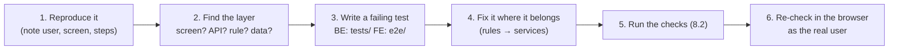

Tips:
- In the browser, open **Developer tools → Network**. The failing `/api/...` call and its message tell you which router to open.
- Errors from the server always come back in one shape: `{"error": {"status_code", "message", "detail"}}`. The `detail` is written for people and is shown in the app.
- **Status codes:** 400 means wrong input or wrong moment; 403 means the wrong person; 404 means not found or not yours to see; 422 means a field is invalid.
- For existing data that needs correcting after a rule change, write an **idempotent script** in `BE/scripts/`: safe to run twice, with a `--dry-run` option. See `sync_format_fields.py` or `convert_image_evidence.py`.

### 8.5 How to add a feature (recipes)

**A new field on templates** (for example "machine number"):
1. Add the column to `Format` in `models_qms.py`. Existing databases need a migration (see `utils/schema_migrations.py`).
2. Accept it in `routers/formats.py` (the payload) and save it in `format_service.py`.
3. Return it in the router's JSON, add it to `FE/src/api/formats.api.ts`, and show and edit it in the designer (`ResponsibilitiesPanel.tsx` or `TemplateDetailsDialog.tsx`).
4. Add a test in `BE/tests/`.

**A new step or rule in the record process:**
1. Put the rule in `record_service.py` or `workflow_service.py`, never in the screen.
2. Write a `RecordEvent` (trail) and an audit entry, and notify the right person (`notify.notify`).
3. Expose any new permission as a `can.<something>` flag in the record JSON (`routers/records.py`). The screen then shows the button only when allowed.
4. Add a label for the new audit action in `routers/audit.py` and, if needed, a link in `notifications.api.ts`.
5. Add tests: service level in `tests/test_qms_record_workflow.py`, HTTP in `tests/test_qms_api.py`, browser in `e2e/02-record-process.spec.ts`.

**A new screen:**
1. Create `FE/src/<newScreen>/index.tsx`; add the route in `App.tsx` (inside `RequireAdmin` if admin-only).
2. Add the menu item in `sidebar/Sidebar.tsx`.
3. Add its API calls in `src/api/<area>.api.ts` with RTK Query `injectEndpoints`; give them tags so lists refresh after changes.
4. Use `base/` components (tables, dialogs, feedback) so it looks and behaves like the rest.

**A new kind of file to import as a template:**
1. Write a handler class in `BE/app/ocr/formats/` implementing `TemplateBuilder` (see `base.py`).
2. Add it to `AVAILABLE` in `ocr/formats/__init__.py`.
3. Add sample files and tests in `BE/tests/ocr/`.

### 8.6 Things that surprise newcomers

| Surprise | Why it is so |
|---|---|
| A released template cannot be edited | Quality rules: every change needs an approved change request and a new revision |
| A record cannot be "rejected" | The process corrects records: **Return for correction**, or **Send back to the CFT** |
| A blank required entry does not stop submission | Process rule B3: an incomplete record still goes forward, and its blanks are shown to every approver |
| Old records still say "rev 00" after a revision | History is never rewritten |
| A check sheet's 31 day cells are not required | A record fills the days that have come; required means "ticked Required in the designer" |
| Times look different in the database | Stored in UTC, shown in India time |
| Two people cannot be PO and OPO on one record | Four-eyes rule, enforced by the server |
| Notifications cannot be switched off | They are the process's own triggers |

### 8.7 Going live (deployment checklist)

- [ ] `.env`: a long random `SECRET_KEY` and `JWT_SECRET_KEY`; `ENVIRONMENT=production`; `AUTHENTICATION_ENABLED=true`; a PostgreSQL `DATABASE_URL`.
- [ ] `APP_BASE_URL` set to the real web address (links in emails use it).
- [ ] `CORS_ORIGINS` set to the web app's address.
- [ ] SMTP settings, if emails are wanted.
- [ ] Build the web app with `VITE_API_URL` pointing at the API; serve it with the provided `nginx.conf`.
- [ ] HTTPS in front of both, and a proxy upload limit of at least the server's `MAX_FILE_SIZE` (100 MB by default). The provided `nginx.conf` does not set one, so add `client_max_body_size` if nginx sits in front of the API.
- [ ] Backups switched on (`/api/backup`, `cli.py backup`).
- [ ] Each real person has their own account and password (`cli.py reset-password`).

---

## Layer 9 — Glossary

| Word | Meaning |
|---|---|
| **Template** (also *format*) | The digital version of a paper form, e.g. **QF-PQ-002** *Daily Initial Flow Management Check Sheet* |
| **Revision** | A version of a template: 00, 01, 02… Only one is active at a time |
| **Record** | One filled copy of a template for one period, e.g. **REC-QF-PQ-002-20261024-01** |
| **Period** | The day / week / month… a record is for, set by the template's frequency |
| **Reading** | One value on a record (a number, ✓/✗, text, date) |
| **Spec / limits** | The allowed range of a reading (e.g. 800–1200 lux) |
| **OK / N-OK** | Within / outside its limits |
| **N-OK flag** | The alert sent to the Overall Process Owner when a record has N-OK readings; must be cleared before filing |
| **PO / OPO** | Process Owner / Overall Process Owner |
| **CFT** | Cross-Functional Team: the joint reviewers |
| **QMS Coordinator** | Owner of the quality management system; approves templates and change requests |
| **DCR** | Document Change Request: asks to change a template or create a new one |
| **RCR** | Record Change Request: asks to correct a filed record |
| **Hard copy** | A scan or photo of the paper sheet attached to a record |
| **Signed PDF** | The record's document with the approval signatures stamped on |
| **Doc Repository** | Where filed records are found, by team / template / date |
| **Resources Library** | Where released templates are found, to start a record |
| **Traffic light (RAG)** | The coloured dot: red / amber (yellow) / green |
| **Four eyes** | A rule that two different people must be involved (here: PO, OPO and CFT are all different) |
| **OCR** | Optical Character Recognition: reading printed text from an image |
| **FE / BE** | Frontend (the web app) / Backend (the server) |
| **API** | The server's addresses (`/api/...`) that the web app calls |
| **Router / Service / Model** | Backend layers: front door / business rules / stored data |
| **IST / UTC** | India Standard Time (shown to people) / Coordinated Universal Time (stored) |

---

### Other documents in this folder

| Document | What it covers |
|---|---|
| `README.md` | Installing and running everything; the main commands |
| `BE/README.md` | Backend details, configuration, the walkthrough of the process screen by screen |
| `INTEGRATION_PLAN.md` | How the frontend and backend were joined, screen by screen; the history of fixes |
| `TEST_PLAN.md` | The acceptance test plan and its results |
| `BE/app/ocr/README.md` | Details of the document-reading package |
